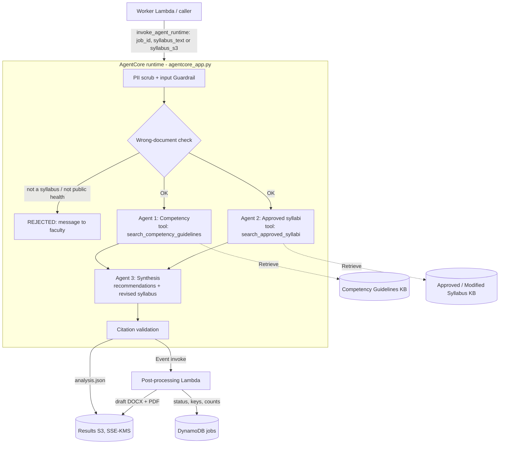

# PHACT agents: three-agent RAG runtime on Bedrock AgentCore

This folder holds the AI half of PHACT: the knowledge-base corpus, the AgentCore runtime with three Strands agents, and the post-processing Lambda. The SAM review workers invoke this runtime through `backend/shared/phact/agentcore.py` when `AgentCoreRuntimeArn` is configured. The runtime returns native review details for the existing faculty decision and versioning workflow. See [application configuration](../../../docs/AGENTCORE.md).

## Architecture



- **Agents 1 and 2 run concurrently** (`asyncio.gather`). If one fails, the run continues with a warning; if both fail, the job fails.
- **Citations are assigned by code, not by the model.** Each search tool records what it returned in an evidence store (`C1, C2…` for competency, `S1, S2…` for syllabi). Any ID an agent cites that was never retrieved is dropped and reported in `warnings`. A recommendation with no valid citation is kept but marked `grounded: false`.
- **Privacy before the model.** Regex + Amazon Comprehend PII redaction runs before any agent sees the syllabus; the Bedrock Guardrail runs on input only (per the Technical document, not on agent output).
- **Wrong documents stop early.** Before any agent runs, `doc_check.py` rejects files that are not a public health course syllabus (a resume, a research article, the wrong course), so they never become an analysis or reach an administrator. Heuristics reject obvious cases without a model call; a small classifier model (`CHECK_MODEL_ID`, Haiku by default) decides the rest and names what the file looks like. A syllabus from another field returns `NOT_PUBLIC_HEALTH`, which faculty can override with `confirm_relevance: true`. If the classifier fails, heuristics decide and unclear files pass with a warning.
- **Output is a DRAFT.** Nothing here approves anything. Approval and export of the approved version belong to the review API.

| Path | What it is |
|---|---|
| `phact_agents/pipeline.py` | The three-agent flow, validation and result assembly |
| `phact_agents/prompts.py` | System prompts #1-#3 (`PROMPT_VERSION`) |
| `phact_agents/schemas.py` | Agent output models and the frontend-facing `AnalysisResult` |
| `phact_agents/evidence.py` | Bedrock KB retriever (ACTIVE + corpus_version filter), local BM25 retriever, evidence store |
| `phact_agents/safety.py` | PII scrub and input guardrail |
| `phact_agents/doc_check.py` | Wrong-document check (heuristics + classifier) |
| `phact_agents/service.py` | Payload handling, S3 result write, post-processing trigger |
| `phact_agents/invoke_client.py` | Helper for the worker Lambda that calls the runtime |
| `agentcore_app.py` | AgentCore entrypoint |
| `phact_rag/` | Corpus preparation CLI and `source_manifest.json` |
| `postprocess/` | Post-processing Lambda (`handler.handler`) and DOCX/PDF rendering |
| `../contracts/` | `analysis.schema.json` + structural example for the frontend and API |

## Contract

The runtime takes:

```json
{"job_id": "job_123", "syllabus_id": "syl_123", "owner_sub": "<cognito sub from the verified JWT>",
 "course_name": "EPID 601", "syllabus_text": "..."}
```

`syllabus_s3: {"bucket", "key"}` (PDF/DOCX/TXT) may replace `syllabus_text`. It returns `{status, job_id, result_key, postprocess_triggered, result}`, where `result` follows [`../contracts/analysis.schema.json`](../contracts/analysis.schema.json). Field names match `frontend/src/types.ts` (`Recommendation`, `CompetencyMapping`, `Citation`) plus `integrationType`, `grounded`, `revisedSyllabus`, `evidence` and `warnings`. [`analysis.example.json`](../contracts/analysis.example.json) shows the shape with placeholder content.

`status` is `SUCCEEDED`, `BLOCKED` (guardrail), `REJECTED` (wrong document; `result.message` and `result.documentCheck` say why) or `FAILED`.

**Check at upload time.** Call the runtime with `{"mode": "check_only", "syllabus_text" | "syllabus_s3": ...}` right after the upload. It runs only the PII scrub, guardrail and wrong-document check (a few seconds) and returns `{status: "CHECKED", accepted, can_confirm, message, document_check}`. Show `message` on the upload screen; when `accepted` is false, don't create the analysis job. When `can_confirm` is true (a syllabus from another field), offer "Analyse anyway" and send `confirm_relevance: true` with the analysis.

The caller (worker) must take `owner_sub` from the verified Cognito token, never from the request body. Regenerate the contract after changing `schemas.py`: `python scripts/export_contract.py`.

## Setup

```bash
python -m venv .venv
.venv/Scripts/python -m pip install -r requirements-dev.txt    # Linux/macOS: .venv/bin/python
.venv/Scripts/python -m pytest tests -q
```

## Deploy (Workshop Studio account, us-east-1)

1. **Build the corpus** from `../../Data`: `python -m phact_rag prepare`. Output goes to `build/v1/{competency,syllabus}/<source>/pNNN.txt` with `.metadata.json` sidecars; the report is `build/report-v1.json`.
2. **Upload**: `python -m phact_rag upload --bucket <kb-source-bucket> [--kms-key-id <key>]` writes `competency/v1/...` and `syllabus/v1/...`.
3. **Create two Knowledge Bases** (Titan Text Embeddings V2, 1024 dims, S3 Vectors). Give each an S3 data source with inclusion prefix `competency/v1/` or `syllabus/v1/`. When creating each vector index, set `AMAZON_BEDROCK_TEXT` and `AMAZON_BEDROCK_METADATA` as non-filterable. Our metadata keys (`status`, `corpus_version`, `source_id`, `page`, …) stay filterable and are small.
4. **Ingest and check**: `python -m phact_rag sync --kb-id <id> --data-source-id <id>`, then `python -m phact_rag query "interpret results of data analysis" --kb competency --kb-id <id>`.
5. **Try it before deploying**: `python scripts/run_local.py "<syllabus.docx>" --render` with the env vars below.
6. **Deploy the runtime** (direct code deploy, no Docker):
   ```bash
   pip install bedrock-agentcore-starter-toolkit
   agentcore configure -e agentcore_app.py
   agentcore launch --env COMPETENCY_KB_ID=... --env SYLLABUS_KB_ID=... --env MODEL_ID=... \
     --env RESULTS_BUCKET=... --env POSTPROCESS_FUNCTION=... [--env GUARDRAIL_ID=... --env GUARDRAIL_VERSION=...]
   ```
   Pass env vars at **launch**, not configure. The runtime role needs `bedrock:InvokeModel*` on both inference profiles (`MODEL_ID`, `CHECK_MODEL_ID`) and their target models, `bedrock:Retrieve` on both KBs, `bedrock:ApplyGuardrail`, `comprehend:DetectPiiEntities`, `s3:PutObject` + KMS on the results prefix, and `lambda:InvokeFunction` on the post-processing Lambda.
7. **Post-processing Lambda**: Python 3.12, handler `handler.handler`, code = `postprocess/*.py` plus `requirements.txt` built for manylinux (command in that file). Its role needs read on `analyses/*`, write + KMS on the outputs bucket, and `dynamodb:UpdateItem` on the jobs table.

| Env var | Used by | Default |
|---|---|---|
| `AWS_REGION` | runtime | `us-east-1` |
| `MODEL_ID` | runtime | `us.anthropic.claude-sonnet-4-5-20250929-v1:0` (inference profile) |
| `COMPETENCY_KB_ID`, `SYLLABUS_KB_ID` | runtime | required |
| `CORPUS_VERSION` | runtime retrieval filter | `v1` |
| `KB_TOP_K` | runtime | `5` |
| `PII_MODE` | runtime | `comprehend` (`regex` / `off` for local tests only) |
| `DOC_CHECK` | runtime | `on` (`off` skips the wrong-document check) |
| `CHECK_MODEL_ID` | runtime | `us.anthropic.claude-haiku-4-5-20251001-v1:0` (confirm access in the account) |
| `GUARDRAIL_ID`, `GUARDRAIL_VERSION` | runtime | unset = no guardrail |
| `RESULTS_BUCKET`, `RESULTS_KMS_KEY_ID` | runtime | unset = result only returned, not stored |
| `POSTPROCESS_FUNCTION` | runtime | unset = no post-processing |
| `OUTPUTS_BUCKET`, `OUTPUTS_KMS_KEY_ID` | post-processing | results bucket |
| `JOBS_TABLE`, `JOBS_TABLE_KEY` | post-processing | unset = skip DynamoDB; key `jobId` |

## For the DB / API owners

- The post-processing Lambda sets these attributes on the job item: `status=COMPLETED`, `reviewStatus=DRAFT`, `resultKey`, `draftDocxKey`, `draftPdfKey`, `recommendationCount`, `mappingCount`, `warningCount`, `corpusVersion`, `completedAt`. Rename them in `postprocess/handler.py` if the table uses other names.
- Export after approval should re-render the **approved, edited** result with `postprocess.render.render_docx/render_pdf`, not reuse the draft files.
- Out of scope for now (team decision): conflicting concurrent edits by an admin and a faculty member.

## Status

| Check | State |
|---|---|
| Unit tests (34): concurrency of Agents 1/2, citation validation, PII before model, guardrail block, wrong-document rejection / override / fallback / check-only mode, partial failure, S3/Lambda/DynamoDB calls, DOCX/PDF rendering, corpus build | Pass locally with fake AWS clients and a scripted agent runner |
| Wrong-document heuristics on real files | All 6 syllabi in `Data/Approved Syllabi` pass; CHW competencies and a workforce fact sheet are rejected; the ASPPH AI Framework passes heuristics alone, which is why the classifier decides non-obvious cases |
| Corpus build from `ASPPH/Data` | 21 sources built (competency 181 pages, syllabus 16 pages); 4 skipped (see below) |
| Strands tool specs and AgentCore entrypoint import | Checked locally |
| Live Bedrock model calls, KB ingestion/retrieval, AgentCore deploy, IAM, latency | **Not verified** - no AWS credentials on the build machine |

Skipped sources: `CDI competencies.webp` and `LSS program management principles.png` (images), `DI_JTA_fact_sheet_updated2026.pdf` (scanned, no text layer) need a reviewed transcription; `MPH_Syllabus_01` is held out as the demo input.

Known risk: Agent 3 writes a full revised syllabus, which can push total time past the ~60 s target. Measure `timingsMs` on the first live run; if needed, lower `SYNTHESIS_MAX_TOKENS` or have Agent 3 return only the changed sections.
