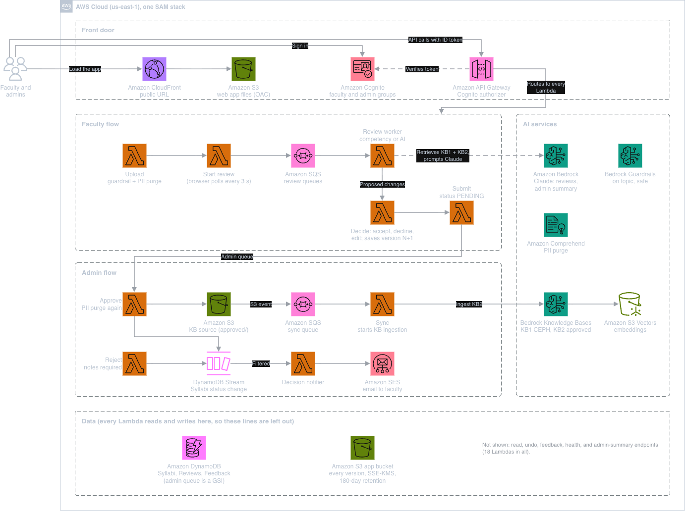

# PHACT — Public Health AI Curriculum Transformation Platform


I worked with my team to build PHACT, an application that helps public health educators review syllabi, identify competency gaps, and integrate AI responsibly. Faculty can review suggested changes, save revised versions, and submit a syllabus for administrator approval.

Built during **AWS Breaking Barriers 2026** with **Team 34 — Health PHACTory**.

[Presentation](docs/presentation/PHACT_Presentation_v13.pptx) · [API contract](docs/api/PHACT_API_Contract.xlsx)

## Demo availability

PHACT was deployed live on AWS during the three-day AWS Breaking Barriers 2026 hackathon. The temporary AWS session has since ended, so the hosted demo is no longer available.

**Local demo: [http://localhost:8443/](http://localhost:8443/)**

Follow the setup instructions below to start PHACT on your computer. The localhost address works while the app is running locally. This demo uses sample data and simulated AI responses.

## Features

- Upload a PDF, DOCX, or pasted syllabus.
- Review coverage of the 22 CEPH foundational competencies.
- Get AI integration and assessment recommendations grounded in retrieved sources.
- Accept, decline, or edit suggestions and compare syllabus versions.
- Submit revisions for administrator approval, with reasons required for rejection.
- Add approved syllabi to the shared knowledge base.
- Export revised syllabi as DOCX or PDF.

## Architecture



The AWS deployment used S3 and CloudFront to host the React app, with Cognito for sign-in. API Gateway and Python Lambda functions handle uploads and reviews, SQS queues background analysis, and Amazon Bedrock supports retrieval and recommendations. DynamoDB stores review state, S3 stores syllabus versions, and Comprehend and Bedrock Guardrails support personal data handling and content checks.

[Editable architecture diagram](docs/architecture/architecture.drawio)

## Tech stack

- **Frontend:** React, TypeScript, Vite
- **Backend:** Python, AWS Lambda, API Gateway
- **AI:** Amazon Bedrock, Knowledge Bases, Guardrails, Amazon Comprehend
- **Storage and processing:** S3, DynamoDB, SQS
- **Authentication and hosting:** Cognito, CloudFront
- **Infrastructure:** AWS SAM / CloudFormation

## Project structure

```text
ASPPH/PHACT/
  frontend/             React application
  backend/              Lambda functions and shared services
  agents/               Three-agent RAG runtime and corpus preparation
  contracts/            Analysis JSON schema and example
  template.yaml         AWS infrastructure
  scripts/              Deployment and integration checks
  tests/                Backend tests and local browser harness
  data/                 Competency references and synthetic syllabi
ASPPH/Data/             Reference documents
archive/frontend/   Earlier frontend implementation
ASPPH/PHACT UX-UI Design/
docs/
  architecture/         Architecture diagram and editable source
  presentation/         Presentation deck
  branding/             Project logo
  api/                  API workbook and CSV exports
  research/             Faculty discovery interview guide
  planning/             Requirements and proposed improvements
```

## RAG pipeline

The [agents module](ASPPH/PHACT/agents/) contains the three-agent Strands workflow, AgentCore entrypoint, reference corpus preparation, citation validation, and DOCX/PDF post-processing.

- [Pipeline](ASPPH/PHACT/agents/phact_agents/pipeline.py)
- [Retrieval and evidence](ASPPH/PHACT/agents/phact_agents/evidence.py)
- [Corpus preparation CLI](ASPPH/PHACT/agents/phact_rag/__main__.py)
- [Analysis contract](ASPPH/PHACT/contracts/analysis.schema.json)
- [Setup and tests](ASPPH/PHACT/agents/README.md)

The queued review workers support the AgentCore runtime through a native review adapter. Faculty decisions, version history, and administrator approval use the same application workflow. See [AgentCore configuration](docs/AGENTCORE.md).

## Run locally

Requires Node.js 22.12+ with npm. Run these commands in Terminal:

```bash
git clone https://github.com/divyamistry2224/PHACT-AI-Curriculum-Platform.git
cd PHACT-AI-Curriculum-Platform/ASPPH/PHACT/frontend
cp .env.example .env.local
npx --yes pnpm install --frozen-lockfile
npx --yes pnpm dev
```

Open **http://localhost:8443/** in your browser and keep Terminal running. If Vite reports another port, use the URL it prints. If you already cloned the repository, start from its `ASPPH/PHACT/frontend` folder and skip the clone command.

The default configuration uses mock data without AWS. See the [application README](ASPPH/PHACT/README.md) for live API configuration, backend tests, and deployment.

## Project status

PHACT is a working application with faculty and administrator workflows, background reviews, and version history. This repository includes the application code, RAG module, architecture, and presentation. The current test suites cover **95 backend tests and 34 RAG tests**, using mocked AWS services and scripted agent responses.

See [implementation status](docs/IMPLEMENTATION_STATUS.md) for current features and planned work.
