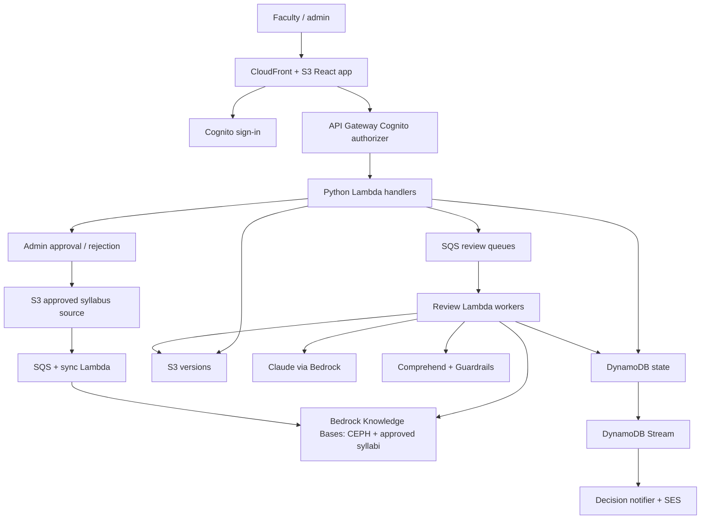

# Architecture: implemented prototype and earlier plans

The image and editable draw.io file were copied from the source repository. The architecture image pasted in chat was not available as a separate downloadable image file; the repository's diagram and the supplied presentation are included instead.

## Current code path

Authority: `ASPPH/PHACT/template.yaml`, `backend/functions/`, and `backend/shared/phact/`.

## Earlier design material

The user supplied a CDK/FastAPI/Strands/AgentCore scaffold and OIDC Hosted UI snippets. Those differ from the inspected implementation: SAM infrastructure, individual Lambda handlers, direct Bedrock calls, and Cognito `USER_PASSWORD_AUTH` with token refresh. They are retained as requirements context, not inserted into the application.

The separate RAG notes describe a reusable Retrieve + Converse module and async adapter. That module's source was not supplied, so it is not represented as integrated or deployed.

## Review lifecycle

Faculty upload → background review → per-suggestion decisions → saved version → submit → pending admin queue → approve or deny. Rejection requires a reason; decisions record administrator identity and time. Approved content is copied to the KB source and synchronized. Review execution and human approval are separate states.

The original chat diagram proposed deleting rejected N+1 drafts. Current code instead composes accepted suggestions, does not create a version when everything is declined, and has constrained undo. See the implementation, not the old diagram, for actual behavior.
